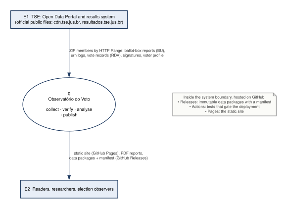
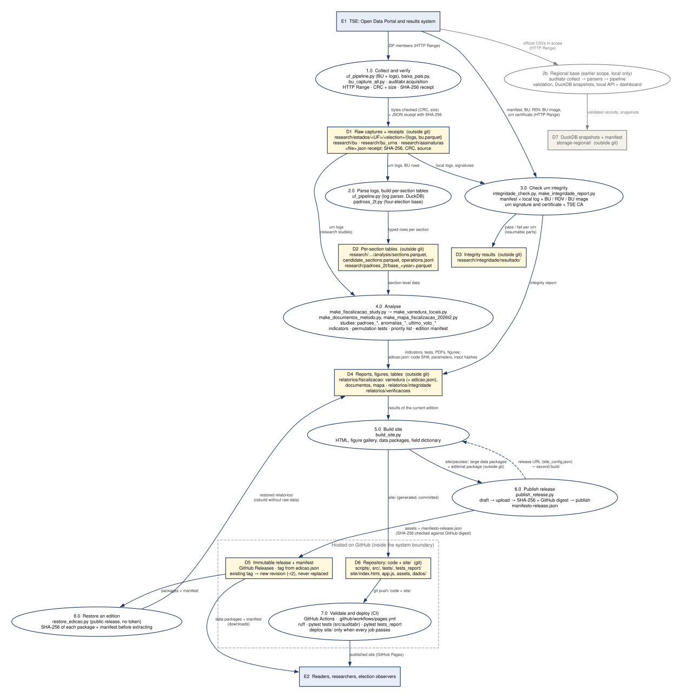

# Data flow diagram (DFD)

How the artefacts of the Observatório do Voto are born, verified, stored and published, with the real scripts and paths of this repository. It complements the [README](../README.md): the README says what each scope does; this page says what moves between them and what is checked at each step. Portable copies: [DFD.pdf](DFD.pdf); sources in [`dfd/`](dfd/).

**Notation.** Rectangle = external entity (outside the system). Ellipse = process (the scripts that transform data). Yellow box = data store, with its real path. Arrow = data flow, labelled with what moves. Dashed arrow = a value handed back (the release URL) that triggers a second build. The dashed frame marks the parts hosted on GitHub, which are inside the system boundary. Grey = earlier scope kept in the repository.

## Level 0 — context



One system, two external parties: the TSE as the only data source, readers and researchers as consumers. GitHub is not an external party: Releases (immutable data packages), Actions (the tests that gate the deployment) and Pages (the static site) are infrastructure inside the boundary.

## Level 1 — processes and data stores



### Processes

| ID | Process | Scripts | Reads | Writes | What is checked |
|---|---|---|---|---|---|
| 1.0 | Collect and verify | `uf_pipeline.py` (BU capture, log collection), `baixa_pais.py`, `bu_capture_all.py`; `auditabr.acquisition.RemoteZipReader` | TSE ZIPs, by HTTP Range (no archive is stored) | D1 | CRC-32 and size of each member against the ZIP central directory; one JSON receipt per capture with SHA-256, source URL and member name |
| 2.0 | Parse logs, build per-section tables | `uf_pipeline.py` (log parser from `analyze_pilot_operations.py`, DuckDB aggregation), `padroes_2t.py` | D1 | D2 | each log's SHA-256 against its receipt before parsing; vote-event count cross-checked by an independent parser; BU totals (eligible = attendance + absent, votes = attendance) |
| 3.0 | Check urn integrity | `integridade_check.py`, `make_integridade_report.py` | D1 (logs, signatures); TSE ZIPs (manifest, BU, RDV, BU image, urn certificate) | D3, D4 | manifest × local log × BU/RDV/image hashes; urn hardware signature; urn certificate chain up to the TSE CA |
| 4.0 | Analyse | `make_fiscalizacao_study.py` → `make_varredura_locais.py`; `make_documentos_metodo.py`; `make_mapa_fiscalizacao_2026t2.py`; research studies (`padroes_*`, `anomalias_*`, `ultimo_voto_*`, …) | D2, plus D1 logs for the studies | D4 | `edicao.json` records the producing code SHA, parameters and the SHA-256 of every input parquet |
| 5.0 | Build site | `build_site.py` | D4, `site/templates/`, `site/site_config.json` | D6 (`site/`), `site/pacotes/` (outside git) | nothing is typed by hand: the site is a function of D4 |
| 6.0 | Publish release | `publish_release.py` | `site/pacotes/`, editorial package, `edicao.json` | D5 | the release is a draft until each asset's local SHA-256 equals the digest GitHub reports; `manifesto-release.json` lists hashes, code SHA, parameters and inputs; an existing tag is never replaced, a new revision (`-r2`) is created |
| 7.0 | Validate and deploy (CI) | `.github/workflows/pages.yml` | D6, on every push and pull request | GitHub Pages | `ruff check src tests`; `pytest tests` (package); `pytest tests_report` (varredura and site); the deploy job needs both and runs only on `main` |
| 8.0 | Restore an edition | `restore_edicao.py` | D5 | D4 | SHA-256 of each package against the release manifest before anything is extracted; public release, no token |
| 2b | Regional base (earlier scope) | `src/auditabr` (`collect`, `parsers`, `pipeline`, `storage`, `cli`) | TSE CSVs in scope | D7 | scope and schema validation, reconciliation issues, immutable DuckDB snapshots with manifest; this is what `pytest tests` covers |

`parsers.py` and `pipeline.py` belong to the regional base only. The current varredura reads D2, which is produced by `uf_pipeline.py`.

### Data stores

| ID | Store | Location | In git? | What keeps it honest |
|---|---|---|---|---|
| D1 | Raw captures + receipts | `research/estados/<UF>/<election>/{logs/, bu.parquet}`, `research/bu/`, `research/bu_urna/`, `research/assinaturas/` | no | one `.json` receipt per file (SHA-256, CRC, source); `remote-inventory.json` lists the members of each ZIP |
| D2 | Per-section tables | `research/…/analysis/{sections,candidate_sections}.parquet`, `operations.jsonl`; `research/padroes_2t/base_<year>.parquet` | no | `summary.json` with the SHA-256 of each parquet; `processing-run.json` with counts and failures |
| D3 | Integrity results | `research/integridade/resultado/<label>/part-*.parquet` | no | resumable parts, one row per urn with the outcome of each check |
| D4 | Reports, figures, tables | `relatorios/fiscalizacao/{varredura,documentos,mapa_2026_T2}`, `relatorios/integridade`, `relatorios/verificacoes` | no | `edicao.json` (edition manifest); restorable from D5 |
| D5 | Immutable release + manifest | GitHub Releases, tag `dados-AAAA-MM-DD[-rN]` | hosted | `manifesto-release.json`: SHA-256 per asset, code SHA, parameters, inputs |
| D6 | Repository: code + `site/` | git | yes | CI on every push and pull request |
| D7 | DuckDB snapshots + manifest (earlier scope) | `storage-regional/` | no | snapshot manifest and `quality_issue` table |

### Where the guarantees live

1. **Capture.** Every file is checked against the ZIP it came from (CRC, size) and gets a receipt with its SHA-256.
2. **Edition.** `edicao.json` ties every result to the code SHA, the parameters and the hash of each input.
3. **Release.** Draft until the hashes match; manifest attached; an existing tag is never overwritten.
4. **Deployment.** The site goes live only when ruff and both pytest suites pass.
5. **Reproduction.** Anyone can rebuild the site from a release, hash-verified, without the raw data and without a token:

```bash
pip install -r requirements-report.lock
python scripts/restore_edicao.py --tag dados-AAAA-MM-DD
python scripts/build_site.py
```

The tag is the one shown on the Releases page.

### Regenerating this diagram

```bash
python scripts/make_dfd.py
```

Needs Graphviz (`dot` on the PATH) or Node with `@viz-js/viz` (`npm i @viz-js/viz`, then `VIZJS_DIR` pointing to that folder), plus PyMuPDF and reportlab. Sources: `docs/dfd/nivel0.dot` and `docs/dfd/nivel1.dot`.
